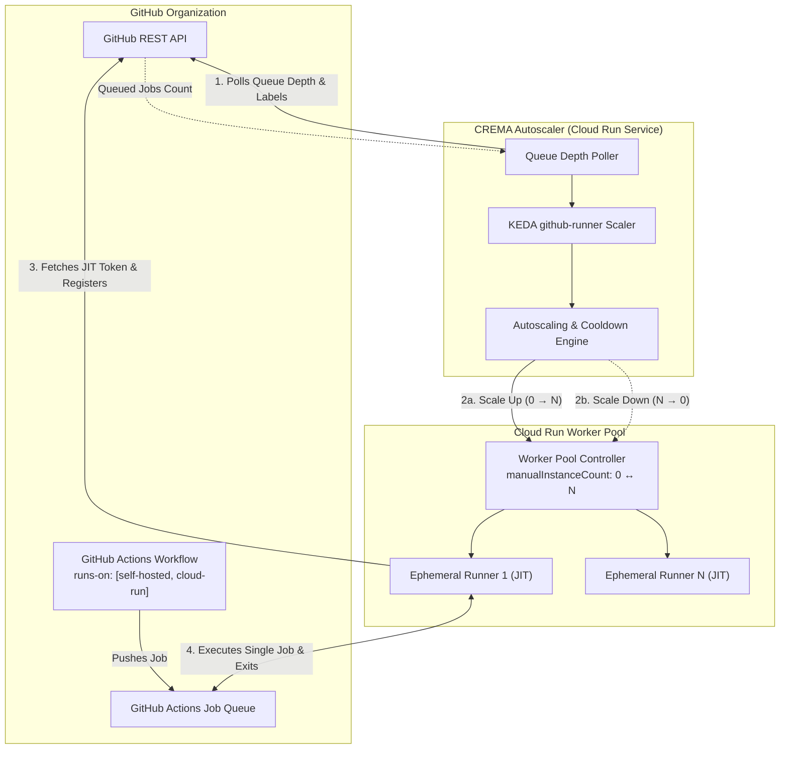

# Production Self-Hosted GitHub Actions Runners on Cloud Run Worker Pools with CREMA (Terraform)

This directory provides a production-ready Terraform deployment for scale-to-zero, organization-level self-hosted GitHub Actions runners on **Cloud Run Worker Pools**, autoscaled by **[CREMA (Cloud Run External Metrics Autoscaling)](https://github.com/GoogleCloudPlatform/cloud-run-external-metrics-autoscaling)**.

Compared to the quickstart sample in `../worker-pool-container`, this configuration adds:

- **GitHub App + Just-In-Time (JIT) ephemeral runners:** No long-lived Personal Access Tokens (PATs); each container signs an RS256 JWT, exchanges it for a short-lived installation token, and registers a single-use JIT runner via GitHub's `generate-jitconfig` API.
- **CREMA autoscaling with Regional Parameter Manager:** Renders `CremaConfig` into a content-hashed regional Parameter Manager version (`create_before_destroy = true`) driving `manualInstanceCount: 0 ↔ N`.
- **Safe Terraform state management:** Uses `lifecycle { ignore_changes = [scaling[0].manual_instance_count] }` so `terraform apply` never resets active runners scaled by CREMA.
- **Regional `resourceLocations` org-policy compliance:** Uses user-managed regional Secret Manager replication, regional Parameter Manager, and regional user-owned Cloud Build staging buckets.

## Architecture



## Prerequisites

1. **Google Cloud Project** with billing enabled and Terraform `>= 1.9.0`.
2. **GitHub App** installed on your target GitHub Organization with:
   - Organization permissions: **Self-hosted runners: Read & write**
   - Repository permissions: **Actions: Read-only**, **Metadata: Read-only**
   - Download the App's **Private Key (`.pem`)**, and note the **App ID** and **Installation ID**.

## Deployment Steps

### 1. Configure Variables

```bash
cp terraform.tfvars.example terraform.tfvars
# Edit terraform.tfvars with your project_id, region, github_org, github_app_id, and github_app_installation_id
```

### 2. Provision Base Infrastructure & Build Runner Image

Because the Cloud Run Worker Pool references the container image in Artifact Registry and mounts the GitHub App private key from Secret Manager, bootstrap the APIs, Artifact Registry, and Secret containers first:

```bash
terraform init
terraform apply \
  -target=google_project_service.apis \
  -target=google_artifact_registry_repository.runner_repo \
  -target=google_secret_manager_secret.github_app_private_key
```

Upload your GitHub App private key out-of-band (never store `.pem` keys in Terraform state):

```bash
gcloud secrets versions add github-app-private-key \
  --project="YOUR_PROJECT_ID" \
  --data-file="/path/to/your-app.private-key.pem"
```

Build and push the ephemeral JIT runner image:

```bash
chmod +x scripts/build_and_push.sh
PROJECT_ID="YOUR_PROJECT_ID" REGION="us-central1" ./scripts/build_and_push.sh
```

### 3. Deploy the Worker Pool & CREMA Autoscaler

```bash
terraform apply
```

### 4. Target the Runners from a GitHub Actions Workflow

```yaml
jobs:
  build:
    runs-on: [self-hosted, cloud-run, linux]
    steps:
      - uses: actions/checkout@v4
      - run: echo "Running on an ephemeral Cloud Run Worker Pool instance!"
```

## Cleanup

```bash
terraform destroy
```
